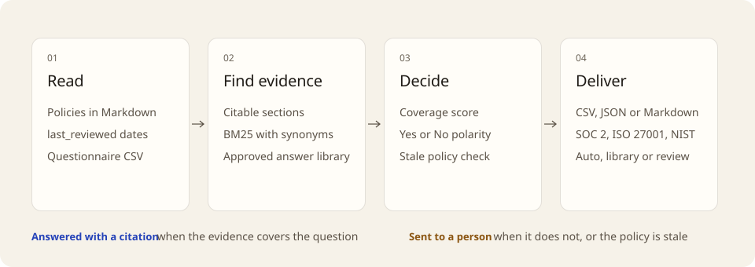
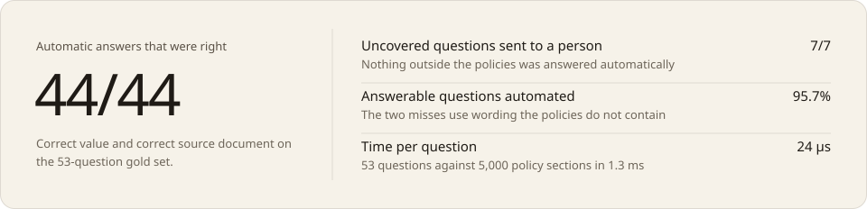

<p align="center">
  
</p>

# QuestProof: security questionnaire automation from your own policies

**QuestProof answers security questionnaires (SIG, CAIQ, vendor security reviews, RFP security sections) from your own policy documents.** Every answer comes with a citation to the policy section, a confidence score and a status. It maps each question to **SOC 2, ISO 27001 and NIST CSF** controls, and sends anything it cannot prove to a person instead of guessing.

<p>
  <a href="#quick-start"></a>
  <a href="#accuracy-and-performance"></a>
  <a href="#control-mapping-and-gap-analysis"></a>
  <a href="#privacy"></a>
  <a href="LICENSE"></a>
</p>

[Quick start](#quick-start) · [How answers are decided](#how-answers-are-decided) · [Control mapping](#control-mapping-and-gap-analysis) · [LLM drafting](#optional-llm-drafting) · [Benchmarks](#accuracy-and-performance) · [FAQ](#faq)

---

## Why GRC and sales-security teams use it

| The problem | What QuestProof does |
|---|---|
| Every customer sends a different 200-question spreadsheet | Reads any CSV with a `question` column and returns the same sheet with answers filled in |
| Reviewers can't trust copy-pasted answers | Every answer cites `policy.md#section` and quotes the sentence it relies on |
| Answers drift from the real policy | Policies past their `last_reviewed` date send their answers to review |
| The same questions arrive with new wording | An approved-answer library is matched on content terms, so "Do you operate a bug bounty program?" reuses the approved answer to "Do you have a bug bounty program?" |
| Auditors want control coverage | Each question maps to SOC 2 TSC, ISO/IEC 27001:2022 Annex A and NIST CSF 2.0, and `coverage` lists the control areas your policies don't address |

## See it work

<p align="center">
  
</p>

## Quick start

```bash
cargo install --git https://github.com/ahmed-raza-shaikh/questproof

questproof answer \
  --policies examples/policies \
  --questionnaire examples/questionnaire.csv \
  --library examples/answer-library.csv \
  --format markdown
```

```
10 questions: 7 auto-answered, 2 from library, 1 need review (90% automated)
```

The default output is CSV, ready to paste back into the customer's spreadsheet, with columns `id, question, answer, status, confidence, citation, evidence, controls, notes`. Use `--format json` or `--format markdown` for other uses, and `--out file` to write to a file.

### Policy files

Markdown or plain text, one file per policy. Front matter is optional:

```markdown
---
title: Access Control Policy
owner: Security Engineering
last_reviewed: 2026-06-15
---

## Authentication
Multi-factor authentication is required for all workforce accounts...
```

Each heading becomes a citable section such as `access-control.md#authentication`.

## How answers are decided

<p align="center">
  
</p>

| Status | When | What you get |
|---|---|---|
| `auto` | The cited section covers the question (IDF-weighted coverage ≥ `--threshold`, default 0.6) and the policy is current | `Yes` / `No` for closed questions, or the quoted evidence sentence for open ones |
| `library` | A previously approved answer matches the question | The approved answer, verbatim |
| `review` | Weak evidence, a stale policy or a rejected LLM draft | The best suggestion and a note explaining why a person is needed |

Polarity is read from the evidence. "Customer data is *never* stored on personal devices" answers **No** to "Is customer data stored on personal devices?".

## Control mapping and gap analysis

```bash
questproof coverage --policies ./policies
```

| Control area | SOC 2 | ISO/IEC 27001:2022 | NIST CSF 2.0 |
|---|---|---|---|
| Access control | CC6.1, CC6.2, CC6.3 | A.5.15, A.5.18, A.8.5 | PR.AA |
| Encryption | CC6.1, CC6.7 | A.8.24 | PR.DS |
| Data lifecycle | C1.1, C1.2 | A.5.12, A.5.33, A.8.10 | PR.DS |
| Logging and monitoring | CC7.2, CC7.3 | A.8.15, A.8.16, A.8.17 | DE.CM |
| Incident response | CC7.4, CC7.5 | A.5.24 – A.5.27 | RS.MA, RS.CO |
| Business continuity | A1.2, A1.3 | A.5.29, A.5.30, A.8.13, A.8.14 | RC.RP |
| Vendor management | CC9.2 | A.5.19 – A.5.22 | GV.SC |
| Secure development | CC8.1 | A.8.25, A.8.28, A.8.31, A.8.32 | PR.PS |
| Vulnerability management | CC7.1 | A.8.8 | ID.RA |
| HR security | CC1.4, CC2.2 | A.6.1 – A.6.4 | PR.AT |

`coverage` marks each area as covered, with the best supporting section, or as a **GAP**. Run it before an audit.

## Optional LLM drafting

```bash
export OPENAI_API_KEY=...   # or set OPENAI_BASE_URL for Azure OpenAI, vLLM or Ollama
questproof answer --policies ./policies --questionnaire review.csv --llm --llm-model gpt-4o-mini
```

The model sees only the retrieved policy excerpts and must cite them by ID. A citation to an excerpt it wasn't given sends the answer to review. Retrieval confidence still decides the status.

## Accuracy and performance

<p align="center">
  
</p>

| Metric | Result |
|---|---|
| Automatic answers with the correct value **and** source document | **44 / 44** |
| Questions not covered by any policy, sent to a person | **7 / 7** |
| Answerable questions automated | **95.7%** (44 / 46) |
| All questions automated | 83.0% (44 / 53) |
| 53 questions against 5,000 policy sections | **1.3 ms** (about 24 µs per question) |
| Indexing 5,000 policy sections | 28 ms |

The two answerable questions that went to review use wording the policies don't contain ("which algorithm *protects*", "logs *protected* against tampering"). That gap is what `--llm` drafting is for.

The 53-question gold set was used while tuning, so treat it as a development set. To measure QuestProof on your own policies, add past questionnaires to `datasets/questionnaire_gold.csv` (`expected_answer` is `Yes`, `No`, `Text` or `Review`) and run `eval`.

```bash
cargo test                                                  # unit, end-to-end and accuracy gate
cargo run --release -- eval --policies examples/policies    # metrics and every miss
cargo bench
```

## Privacy

Nothing leaves your machine unless you pass `--llm`. Policies, questionnaires and answers stay local files.

## FAQ

<details>
<summary><b>Which questionnaire formats are supported?</b></summary>

Any CSV with a `question` column; `id` is optional. Export SIG, CAIQ or customer spreadsheets to CSV, then paste the answer columns back.
</details>

<details>
<summary><b>Can I use PDF or Word policies?</b></summary>

Convert them to Markdown first, for example with `pandoc policy.docx -o policy.md`. Headings become citable sections.
</details>

<details>
<summary><b>Will it make up answers?</b></summary>

It's built to fail safe. With low evidence coverage or a stale policy the answer becomes `review`, and LLM drafts with citations to excerpts the model wasn't given are rejected.
</details>

<details>
<summary><b>How is this different from a trust-center SaaS?</b></summary>

QuestProof is a local, open-source engine: your policies stay on your machine, every answer is traceable to a section, and you can wire it into your own trust center or ticketing flow.
</details>

## Roadmap

- XLSX input and output with the original layout preserved
- Embedding-based retrieval as an optional second stage
- Answer-library export from reviewed results

## CI

The workflow at `ci/github-actions.yml` runs fmt, clippy, tests, the accuracy report and coverage. Copy it to `.github/workflows/ci.yml` to enable it.

## License

MIT
